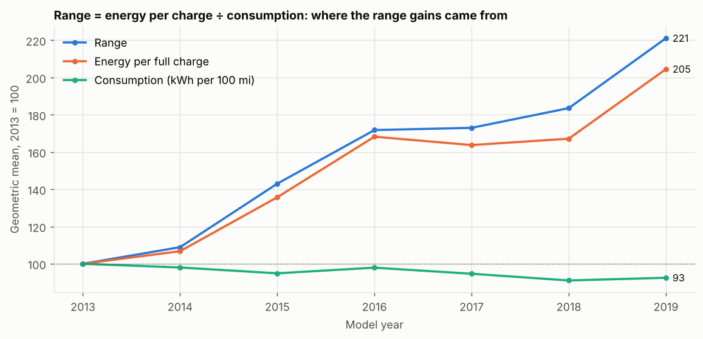
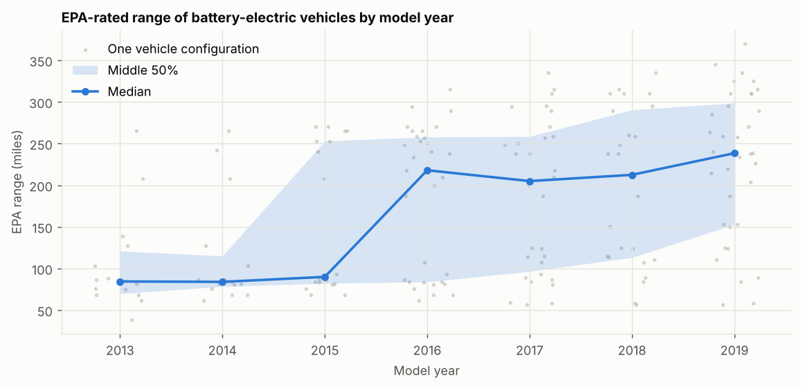
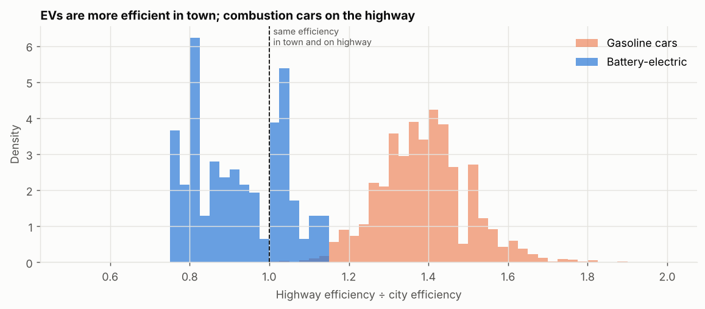
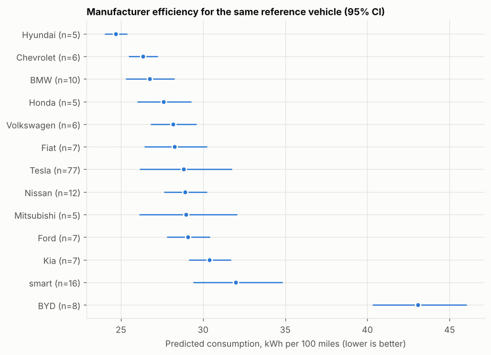
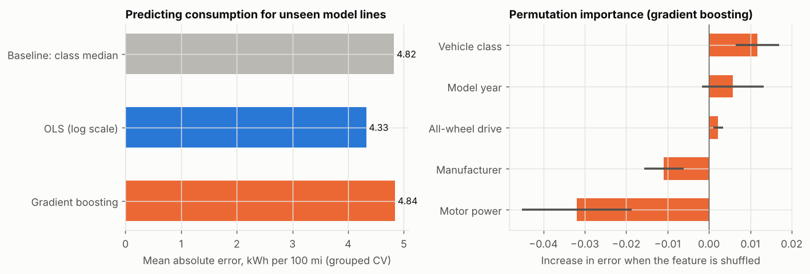

# EV battery range analysis

[](https://github.com/didargumus/ev-battery-range-analysis/actions/workflows/tests.yml)
[](https://github.com/didargumus/ev-battery-range-analysis/actions/workflows/refresh.yml)


The rated range of electric cars offered in the US has grown a lot since the early 2010s. This project uses the official EPA fuel economy data to ask where that gain came from: bigger batteries, or cars that use less energy per mile? It then looks at what determines that energy use (size, drivetrain, power, manufacturer) and tests whether a model can predict it for cars it has not seen.

The data is downloaded from [fueleconomy.gov](https://www.fueleconomy.gov/feg/download.shtml) by a scheduled GitHub Actions job once a month. The job reruns the whole analysis, so the figures, tables and the findings below always match the latest EPA file.

<p align="center"></p>

## Findings

The text between the markers below is written by `scripts/run_analysis.py` from the numbers, so it updates with the data.

<!-- results:start -->
Data: 186 battery-electric vehicle configurations from 20 manufacturers, model years 2011 to 2020 (EPA file obtained October 2019, via the TidyTuesday mirror; replaced by the latest file on the first refresh). Trend figures use model years with at least 10 configurations (2013 to 2019).

1. The median EPA range went from 84 miles in 2013 to 238 miles in 2019. The geometric-mean range changed by +121%, energy per full charge by +105% and consumption by -7%. Bigger batteries account for 90% of the (log) range gain and lower consumption for the remaining 10%.
2. The derived energy per charge passes a sanity check. For the 56 configurations whose battery size EPA lists, the stated capacity is a median 0.89 times the energy drawn from the wall, consistent with charging losses of about 11%.
3. The share of SUVs and pickups among EV configurations went from 14% to 25%. In the regression below an SUV uses 28% more energy per mile than a car of the same model year and motor power, so the shift towards SUVs pushes average consumption up.
4. EVs reverse the usual city/highway pattern. The median EV's highway efficiency is 0.90 times its city efficiency, against 1.38 for gasoline cars. 99.9% of gasoline cars but only 34% of EVs are more efficient on the highway.
5. For the same reference vehicle (two-wheel-drive car, median motor power, model year 2020), predicted consumption ranges from 24.7 kWh/100 mi (Hyundai) to 43.1 kWh/100 mi (BYD).
6. On model lines the models had never seen, OLS (log scale) had the lowest error (MAE 4.33 kWh/100 mi, 12.1% of the true value), 10% below the class-median baseline.

#### Explanatory regression: log consumption (HC3 robust standard errors)

n = 185, R² = 0.47

| Term | Effect on consumption | 95% CI | p-value |
|---|---:|---:|---:|
| Class: SUV (vs car) | +28.1% | [+20.7%, +35.9%] | 0.000 |
| Model year (+1) | -2.9% | [-3.8%, -2.0%] | 0.000 |
| All-wheel drive | +1.6% | [-4.8%, +8.3%] | 0.637 |
| Motor power (+10%) | +0.2% | [-0.2%, +0.6%] | 0.348 |

#### Predictive models: grouped 5-fold cross-validation by model line

| Model | MAE (kWh/100 mi) | MAPE | R² |
|---|---:|---:|---:|
| Baseline: class median | 4.82 | 13.6% | -0.12 |
| OLS (log scale) | 4.33 | 12.1% | 0.05 |
| Gradient boosting | 4.84 | 13.4% | -0.24 |
<!-- results:end -->

## Method

### Range decomposition

EPA reports, for each vehicle, the rated range $R$ (miles) and the combined consumption $c$ (kWh per 100 miles, measured at the wall plug). Their product gives the energy drawn for one full charge, $E = R\,c/100$. Since $R = 100\,E/c$ holds for every vehicle, the average of the logs within a model year splits exactly:

$$
\overline{\log R} = \log 100 + \overline{\log E} - \overline{\log c}.
$$

The geometric-mean range therefore changes by the change in energy per charge minus the change in consumption, with nothing left over. Medians do not have this property, which is why the decomposition uses geometric means. $E$ includes charging losses, so it is an upper bound on usable battery capacity (wall-to-battery efficiency is roughly 85 to 90 percent).



### City and highway efficiency

Combustion engines waste fuel when idling and at low load, so they are more efficient on the highway. Electric motors are efficient at any load and recover energy when braking, while aerodynamic drag grows with the square of speed. EPA's city and highway ratings show the effect directly:



### What determines consumption

The explanatory model is an OLS regression of log consumption on model year, vehicle class (car, SUV, pickup, van), all-wheel drive and log motor power, with HC3 heteroskedasticity-robust standard errors. With the target in logs, each coefficient is a percentage effect. Adding manufacturer dummies gives every make's predicted consumption for one identical reference vehicle, which compares brands after controlling for the size and power of the cars they sell:



### Prediction for unseen cars

Three models predict consumption: the median of the vehicle's class (baseline), OLS on the same features, and gradient boosting (`HistGradientBoostingRegressor`). They are scored with grouped 5-fold cross-validation, where every trim and model year of a model line stays in the same fold. Ordinary K-fold would place, say, the 2023 and 2024 versions of the same car in training and test sets and report an error that is too optimistic. Permutation importance is computed on model lines held out from training.



## Data cleaning

| Step | Rule |
|---|---|
| Vehicle type | `atvType == "EV"` and `fuelType1 == "Electricity"` (battery-electric only; plug-in hybrids excluded) |
| Model years | 2011 onward. Earlier entries are mostly lead-acid fleet conversions |
| Validity | range > 0 and consumption > 0 |
| Vehicle class | EPA size classes collapsed into car, SUV, pickup and van |
| Motor power | parsed from the free-text `evMotor` field (formats such as `150 kW ACPM`, `193 (front) 193 (rear)`, `Front: 160 kW Rear: 160 kW`); rows without a power figure are left out of the regressions only |
| Model line | make plus the first two words of the model name with trim words removed, used to group cross-validation folds |

Each row is one vehicle configuration, not one car sold. The trends describe what was offered, not what people bought; EPA does not publish sales.

## Quick start

```bash
git clone https://github.com/didargumus/ev-battery-range-analysis.git
cd ev-battery-range-analysis
pip install -e ".[dev]"
pytest                          # tests use a synthetic dataset, no download needed
python scripts/run_analysis.py  # downloads the EPA file and regenerates everything
```

## Project structure

```
ev-battery-range-analysis/
├── src/evrange/
│   ├── data.py        # download, cleaning, parsing of motor power and battery size
│   ├── analysis.py    # yearly summaries, range decomposition, city/highway comparison
│   ├── models.py      # OLS with robust errors, manufacturer effects, grouped CV, permutation importance
│   └── report.py      # figures, results page, README findings
├── scripts/run_analysis.py
├── tests/
├── data/ev_clean.csv  # cleaned EV table, rewritten by each refresh
├── docs/              # figures, results.md, headline.json
└── .github/workflows/ # tests on every push; monthly data refresh
```

## Limitations

* EPA ratings come from standardised lab cycles. Real-world range depends on temperature, speed and driving style.
* There are no sales weights, so a niche trim counts as much as a best-seller.
* Battery capacity is not reported consistently, so energy per charge is derived from range and consumption.
* Motor power is parsed from free text and is missing for some vehicles.

## License

MIT. See [LICENSE](LICENSE). The EPA data is a U.S. government work in the public domain.
